<div align="center">



<br>


<a href="https://linkedin.com/in/theawais77"></a>
<a href="mailto:theowais456@gmail.com"></a>
<a href="https://ventrr.tech"></a>

</div>

---

I build APIs in NestJS and FastAPI, then take them to production myself — containers, reverse proxy, TLS, CI, and restarts that don't drop in-flight work.

Final-year Computer Science at Air University, Islamabad. Preparing Microsoft AZ-204.

<div align="center">


</div>

---

## What I'm running

```makefile
services:

  ventrr:
    role:      final year project — investor-readiness platform for pre-seed founders
    stack:     next.js  ->  nestjs core-api  ->  fastapi ai-service
    data:      postgres + pgvector, bullmq queues, prisma
    infra:     docker compose behind caddy, automatic TLS, per-service github actions
    intel:     12 langgraph agents, pydantic-validated output, multi-provider llm routing
    decision:  runway / LTV / CAC payback computed in the backend, not by a model
               — the formula is printed next to every figure
    url:       https://ventrr.tech
    source:    private

  dock-ship:
    role:      zip archive or public github repo  ->  live azure container app
    stack:     fastapi, react, azure container apps + container registry
    pipeline:  analyse -> dockerfile -> build -> push -> deploy -> health check -> live url
    analyser:  deterministic and rule-based across 5 runtimes
               — every detected value links to the evidence that produced it
    hardening: zip path traversal, symlinks, zip bombs, entry and size caps
               immutable per-deployment image tags
    built_at:  sequel technologies

  shadow-vault:
    role:      self-destructing file vault
    stack:     nestjs, postgres, redis bull queue, docker compose
    infra:     aws ec2, s3, cloudfront signed delivery
    crypto:    aes-256 at rest, jwt-signed access tokens, configurable expiry
    source:    theawais77/shadow-vault-server

  receipt-tracker:
    role:      serverless receipt OCR pipeline
    stack:     azure functions, cosmos db, blob storage, static web apps
    security:  key vault + managed identity — no secrets in app settings
    source:    theawais77/Receipt-Tracker-Serverless-OCR-Pipeline-on-Azure
```

---

## What I actually know

| | |
|---|---|
| **Comfortable** | NestJS · FastAPI · TypeScript · Node.js · Python · PostgreSQL · Redis · Docker · Docker Compose · Linux |
| **Ship with it** | Azure Container Apps · Container Registry · Azure Functions · Caddy · Nginx · GitHub Actions · BullMQ · Prisma |
| **Working on it** | AZ-204 · pgvector and retrieval · LangGraph · Kubernetes |
| **Can read, won't claim** | React · Next.js · C# / ASP.NET · C++ |

That last row is deliberate. I'd rather say what I can't do than get found out in an interview.

---

## Worth a look

- **[Azure-serverless-Streaming-backend](https://github.com/theawais77/Azure-serverless-Streaming-backend)** — Durable Functions orchestrating parallel workstreams, Cosmos DB, AI content moderation.
- **[logistics-delivery-management](https://github.com/theawais77/logistics-delivery-management)** — built to go deep on Postgres rather than on features: transactions, row locks, indexes, `EXPLAIN ANALYZE`, ACID behaviour under contention.
- **[CryptoSentinel](https://github.com/theawais77/CryptoSentinel)** — TLS certificate discovery and post-quantum readiness analysis. Redis-backed scanner worker.
- **[OS-Multithreaded-Download-Manager](https://github.com/theawais77/OS-Multithreaded-Download-Manager)** — C++, thread pools, scheduling and synchronisation. CMake + libcurl.

---

<sub>Black Hat MEA 2025 CTF — global finalist, top 125 of 1,200+ teams, Riyadh, with team AIRvanguard. Operations Lead, AWS Cloud Club — Air University.</sub>
